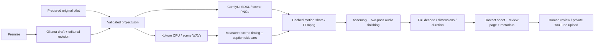

# Production architecture

The dashboard is a loopback-only Python HTTP service with one production thread. Writes require a custom header and same-origin requests, Host values are restricted, project IDs are bounded, and media serving rejects path traversal. It has no authentication/tenancy model and must not be exposed as a public service. No shell strings, downloaded custom ComfyUI nodes or user-supplied executable graphs are run by the new pipeline.

External inference endpoints must be local HTTP origins. Local service sessions ignore inherited outbound proxies, preventing localhost inference traffic from being sent through a configured remote proxy. Model-file downloads use normal HTTPS verification and the environment's normal network settings. They are a separate explicit command and record source URLs and file hashes. Hashes record what was downloaded, not a separately verified publisher signature.

Ollama uses `keep_alive: 0`, and ComfyUI receives a model-freeing request after generation and before a new story request. This reduces GPU competition but does not establish an exclusive GPU lock across unrelated applications or other ComfyUI jobs. Pipeline stages run sequentially. The per-project lock prevents concurrent writes to that project; the dashboard also permits only one job at a time.

Audio, images and rendered clips are cached by content/configuration signatures. Scene numbers are generated internally. Imported art is supported with an explicit `art_source: manual` marker. Existing voice takes can be rendered with the standalone render stage; the full run regenerates narration. The user can inspect/edit every project artifact.

Frame-rounding is reflected in narration padding so accumulated per-shot video rounding does not create an end-of-film drift. Captions are shifted along with the shot boundaries. Caption subdivisions within synthesized speech chunks remain estimated. Mixing and loudness measurements are saved, and exports are decoded completely for basic corruption checks. These technical checks do not judge editorial quality or certify loudness/perceptual perfection on every playback system.

Current limits: no continuous character animation, lip-sync, reference-image identity control, automatic stock-footage licence assessment, sophisticated score generation, automated YouTube upload, Google OAuth, publishing scheduler, multi-user hosting or automatic channel creation. The original legacy scripts remain separate and are not used by the new studio's fiction runner.
